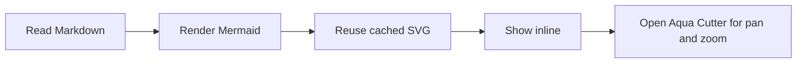
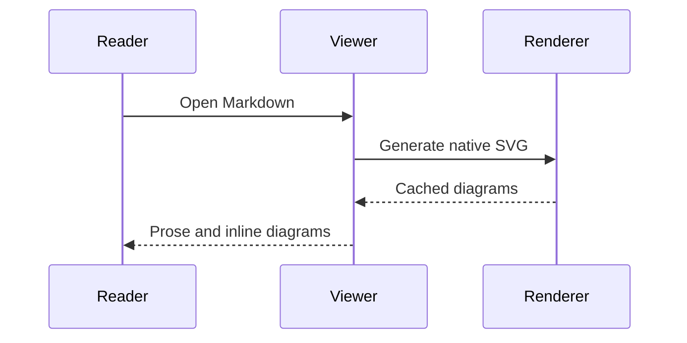
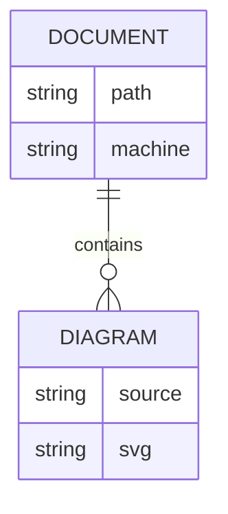

# Markdown + Aqua

This is an explicitly **synthetic document** for the experimental native reader. The Markdown stays readable, with diagrams placed between the sections they explain.

## A small workflow

1. Read a document.
2. Generate each Mermaid diagram.
3. Keep the prose and pictures together.



The paragraph after the diagram remains part of the same scrolling document. **Colour** changes diagram palettes; **Flowchart edges** changes their routing without editing this file.

## A conversation



Normal code fences remain code, not diagrams:

```js
const greeting = "Hello from the native Markdown reader";
```

## A small data model



## Links and formatting

| Feature | In this experiment |
| --- | --- |
| Prose, headings and lists | Native Markdown |
| Mermaid | Native inline SVG |
| Pan and zoom | Existing Aqua Cutter inspector |
| Source editing | Never |

A [relative Markdown link](README.md) opens in this reader; **Back** returns here. A [reference link][manual] also works across diagram boundaries.

[manual]: https://gpui-kit.com "GPUI Kit"

> This is a disposable experiment, not a Markdown editor. Local images, heading jumps and diagram fences nested inside lists or blockquotes are not supported yet.
